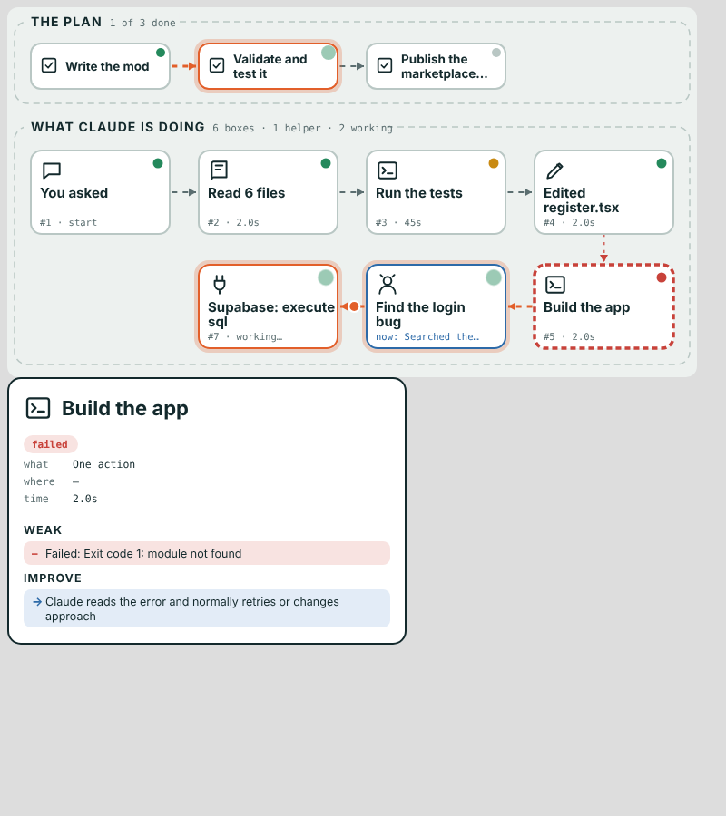

# live-flow

A Claude Code mod that opens a live side pane showing what Claude is doing, as boxes and moving arrows:

- **The plan**: the steps Claude set itself (its task list), each with a status dot.
- **What Claude is doing**: every action as a card (running a command, editing a file, a web search, a connected app such as Supabase or Gmail), in order, joined by animated arrows. A dot travels along the arrow into whatever is running right now.
- **Helpers**: each subagent Claude starts gets its own blue card showing its task, how many steps it has taken and what it is doing now.
- Tap a step's button under the drawing to open its card: what it did, where, how long it took, and good / weak / improve notes.

Dot colours: green = done or working, amber = finished but slow, red = failed.



## Install (once, then it is in every session)

Type this at the prompt of a Claude Code terminal session:

```
/plugin install live-flow --marketplace spiros-ui/live-flow
```

Answer `y` to add the marketplace, then pick the **user** scope. From then on every session (terminal, desktop app, mobile app, cloud sessions under your account) loads it. Type `/flow` to open the pane if it is not already showing.

## What it shows and what it doesn't

- It shows **actions** (tools, helpers, plan steps), not Claude's private reasoning.
- Quick look-ups in a row (reading files, searching code, web lookups) fold into one box, and only the most recent 25 boxes are kept, so the drawing stays readable.
- Times are real. Token counts appear only for helpers, which report them; ordinary steps do not report a cost.
- The terminal has no vector drawing, so there it shows a simple list with arrows.

## Develop

```
claude plugin validate .
claude plugin test .
```
